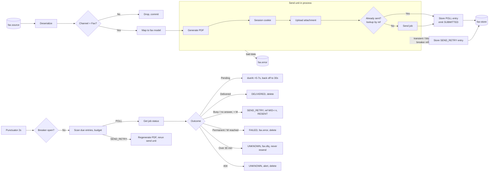

# RightFax Delivery: Kafka Streams, Send Unit in process(), Status Polling from the State Store

## 0. How to use this document

This is the complete implementation specification. Implement exactly what is described.

- **TO CONFIRM** marks an open decision. Use the stated default and keep it configurable.
- Do **not** invent RightFax endpoint paths, request/response fields, cookie behaviour beyond what is stated, or job status values. Take them from the RightFax API documentation and put them in configuration.
- **VERIFY** marks framework behaviour to check against the library versions in use.

---

## 1. Summary

A Kafka Streams application (Spring Boot) that delivers faxes through RightFax.

1. For each fax message, `process()` runs the **send unit** in one go: get session cookie (login only if needed) → upload attachment (temp URL) → look up job by reference → send job (jobId).
2. On success, only what is needed for polling is written to a RocksDB state store as a `POLL` entry, and a SUBMITTED status event is emitted.
3. A **wall-clock punctuator** (every 2s) scans the store and calls **Get job status** for due `POLL` entries until a terminal outcome or a 30-minute window.
4. If the send unit fails transiently, the request is parked in the same store as a `SEND_RETRY` entry, and the punctuator reruns the whole send unit later.
5. One shared **session manager** holds the `rf-session` cookie in memory. One **circuit breaker** wraps every RightFax call. When the breaker opens, stream bindings stop.

Per-call staging (a separate store state per call) is deliberately **not** used: repeating login (cached) and upload (fresh temp URL) is harmless, and the only dangerous call, send, is protected by the reference lookup (§8), which staging would not replace.

---

## 2. Scope and assumptions

- Spring Boot, Kafka Streams with the Processor API for the stateful part, Resilience4j CircuitBreaker, an HTTP client with explicit timeouts.
- `processing.guarantee=exactly_once_v2`.
- State store: RocksDB, changelog-backed, `num.standby.replicas=1`.
- **No dedup stage.** Duplicate input is the upstream producer's responsibility.
- One input message = one fax, key = `MID` (unique message ID).
- Per-recipient ordering not required (TO CONFIRM).
- RightFax calls: **Login**, **Upload attachment**, **Send job**, **Get job status**, plus **Find job by reference** (TO CONFIRM support, §8). All on the same RightFax server.

---

## 3. Topology

```
fax.source
  → deserialize            (failure → fax.error)
  → filter channel == FAX  (others dropped)
  → map to fax model       (failure → fax.error)
  → FaxProcessor           (Processor API, store: fax-store)
        ├─ sink: fax.status
        ├─ sink: fax.error
        └─ sink: fax.dlq
```

PDF generation happens inside `FaxProcessor` (start of the send unit) so a `SEND_RETRY` can regenerate it from the stored request. A PDF failure is a non-retriable error (→ `fax.error`).



---

## 4. Topics

| Topic | Key | Purpose |
|---|---|---|
| `fax.source` (name TBD) | MID | Input, all channels |
| `fax.status` | MID | Lifecycle events |
| `fax.error` | MID | Non-retriable data errors and permanent fax failures |
| `fax.dlq` | MID | Send retries exhausted; poll window exceeded (UNKNOWN) |
| `<app>-fax-store-changelog` | MID | Internal, Kafka Streams |

Rules:
- All outputs are topology sink nodes (`context.forward(..., "fax-status-sink")` etc.). Never use `KafkaTemplate` inside the topology: it is outside the exactly-once transaction and duplicates on replay.
- All consumers of these topics use `isolation.level=read_committed`.

### 4.1 Status event (`fax.status`)

```json
{
  "mid": "string",
  "status": "SUBMITTED | DELIVERED | FAILED | RESENT | UNKNOWN",
  "jobId": "string | null",
  "reference": "MID or MID-r{n}",
  "resendCount": 0,
  "reason": "string | null",
  "rightfaxStatus": "string | null",
  "timestamp": "ISO-8601"
}
```

### 4.2 Error / DLQ record

Payload: original request (never the PDF). Headers: `mid`, `stage` (DESERIALIZE, MAP, PDF, LOGIN, UPLOAD, LOOKUP, SEND, POLL), `errorClass`, `httpStatus`, `attempts`, `reference`, `jobId`, `reason`, `timestamp`. Never the cookie or credentials.

---

## 5. State store

One RocksDB key-value store `fax-store`, key `MID`, logging enabled.

```java
enum State { POLL, SEND_RETRY }

record FaxEntry(
    String mid,
    State state,
    String jobId,          // POLL only
    String reference,      // MID, or MID-r{n} after resend
    Instant submittedAt,   // POLL only, start of the 30-min window
    Instant dueAt,         // next time the punctuator acts
    int attempts,          // SEND_RETRY: send-unit attempts so far
    int resendCount,       // busy / no-answer resends so far
    FaxRequest request,    // original request, needed to regenerate PDF and resend
    String lastError
) {}
```

- Never store the PDF. Regenerate from `request` on retry. Keeps changelog records small.
- No secondary due index: in-flight entries are bounded by roughly 30 minutes of volume, so a full scan per tick is cheap. Add a `dueAt|MID` index store only if in-flight entries reach tens of thousands.
- Serde: JSON or Avro, versioned so the schema can evolve.

---

## 6. FaxProcessor

### 6.1 init()

- Get `fax-store`.
- `context.schedule(Duration.ofSeconds(2), PunctuationType.WALL_CLOCK_TIME, this::punctuate)`.

### 6.2 process(record)

```java
public void process(Record<String, FaxRequest> rec) {
    FaxRequest req = rec.value();
    String ref = req.mid();                     // first submission
    try {
        String jobId = sendUnit(req, ref);
        putPoll(req, ref, jobId, 0);            // POLL, submittedAt=now, dueAt=now+6s
        emit(req, SUBMITTED, jobId, ref, 0, null);
    } catch (Exception e) {
        handleSendFailure(req, ref, 0, 0, e);
    }
}
```

### 6.3 sendUnit(request, reference)

1. Generate PDF from the request. Failure → `FaxDataException` (non-retriable).
2. `findByReference(reference)`: if a job exists, return its jobId (no upload, no send).
3. `upload(pdf)` → temp URL.
4. `sendJob(tempUrl, recipient, reference)` → jobId.

Every call goes through the session manager (§7) and the breaker (§9). Steps 3–4 may be ordered after step 2 as shown, so a replay after a crash does not even re-upload.

In-thread retries: for transient errors only, retry the whole unit up to 2 times, 1 second apart, before parking. Most blips clear without touching the store.

### 6.4 handleSendFailure(request, reference, attempts, resendCount, error)

| Class | Examples | Action | Breaker |
|---|---|---|---|
| Session expired | 401 on a non-login call | Handled in the session manager (re-login, repeat once). Never reaches here. A second 401 → Blocking. | No |
| Transient | 5xx, 408, 429, connect/read timeout, connection reset | If `attempts + 1 < 5`: put `SEND_RETRY` with `attempts+1`, `dueAt = now + backoff(attempts+1)`. Else: `fax.dlq` (reason retries exhausted), emit FAILED, alert, delete entry if present. Honour `Retry-After`. | Yes |
| Bad data | 400, 422, invalid fax number, rejected PDF, mapping/PDF failure | `fax.error`, emit FAILED, delete entry if present | No |
| Blocking | Login fails (credentials), 403, TLS / certificate, DNS | Put `SEND_RETRY` **without** incrementing attempts, `dueAt = now + 30s`; alert on login failure | Yes |
| Breaker refused | `CallNotPermittedException` | Put `SEND_RETRY` without incrementing attempts, `dueAt = now + 30s` | No |

Send backoff: 30s, 1m, 2m, 5m, 10m (±20% jitter). `MAX_SEND_ATTEMPTS = 5`.

A request that reached `fax.dlq` from send exhaustion was **never sent** (or the lookup would have found it) and is safe to replay.

### 6.5 punctuate(now)

```java
void punctuate(long now) {
    var st = breaker.getState();
    if (st == OPEN) return;
    int budget = (st == HALF_OPEN) ? 3 : 20;
    try (var it = store.all()) {
        while (it.hasNext() && budget > 0) {
            FaxEntry e = it.next().value;
            if (e.dueAt().toEpochMilli() > now) continue;
            budget--;
            if (e.state() == POLL) poll(e, now); else retrySend(e, now);
        }
    }
}
```

All store writes, deletes and forwards inside `punctuate()` are part of the exactly-once transaction.

### 6.6 poll(entry, now)

First check the window: if `now - submittedAt > 30 min` → emit UNKNOWN (reason poll window exceeded), forward to `fax.dlq` with jobId, alert, delete. **Never resend**: the fax may have gone out.

Otherwise call **Get job status** (jobId + cookie) and map the RightFax status via configuration (TO CONFIRM values):

| Outcome | Action |
|---|---|
| Pending / in progress | `dueAt = now + random(5s..7s)`; once `now - submittedAt > 5 min`, use 30s |
| Delivered | Emit DELIVERED, delete |
| Busy / no answer, `resendCount < M` | Replace entry with `SEND_RETRY`: `resendCount+1`, `reference = MID-r{resendCount+1}`, `attempts = 0`, `jobId = null`, `dueAt = now + 30s`; emit RESENT |
| Busy / no answer, `resendCount ≥ M` | Emit FAILED (resends exhausted), `fax.error`, delete |
| Permanent failure (invalid number, rejected, cancelled) | Emit FAILED, `fax.error`, delete |
| Job not found (404) | Emit UNKNOWN, alert, delete. No resend. |
| Status call transient error | Keep entry, `dueAt = now + 30s`; the 30-minute window still governs |
| Status call blocking error | Breaker failure; keep entry, `dueAt = now + 30s` |
| Breaker refused | Leave entry untouched |

`M` default 2 (TO CONFIRM; set 0 if RightFax retries busy numbers itself).

### 6.7 retrySend(entry, now)

Run `sendUnit(entry.request, entry.reference)` (regenerates the PDF).
- Success → replace with `POLL` entry (`submittedAt = now`, `dueAt = now + 6s`), emit SUBMITTED.
- Failure → `handleSendFailure(request, reference, entry.attempts, entry.resendCount, error)` (§6.4).

---

## 7. RightFax session manager

Shared Spring bean, used by every RightFax call.

- **Login** returns the `rf-session` cookie; every other call sends it.
- **Cache: in memory, per instance** (`AtomicReference` or one-entry Caffeine). Never in the state store, Kafka, logs, or a shared cache. App restart = one fresh login; nothing else is lost (all fax state is in the changelog-backed store).
- **Single-flight**: concurrent callers share one login.
- **Proactive refresh** before expiry if RightFax documents a session lifetime (TO CONFIRM).
- **401** on a non-login call: drop cookie, re-login, repeat the call once; not counted as an attempt. Second 401 → Blocking.
- **Login failure** (credentials, 403, TLS, DNS): Blocking, breaker failure, alert.
- **Security**: mask cookie and credentials in all logs; credentials from secrets.
- **Concurrent sessions** (TO CONFIRM): each instance logs in separately. If a new login invalidates other instances' sessions, a shared session is needed.

---

## 8. Duplicate-send protection (critical)

Exactly-once covers store writes, sinks and offsets, not RightFax. If the app crashes after **Send job** succeeds but before the transaction commits, the store rolls back and the record (or the `SEND_RETRY` entry) runs the send unit again.

Protection, in order of preference:
1. **Find job by reference** at the start of every send unit (§6.3 step 2). If found, reuse the jobId. TO CONFIRM RightFax supports a client reference and which field carries it.
2. If RightFax rejects duplicate references, treat the rejection as "already sent" and fetch the jobId.
3. If neither exists: write an external idempotency marker (small table) **before** send, outside the Kafka transaction. On rerun, if the marker exists, alert for manual check instead of sending.

Each resend uses a new reference (`MID-r{n}`) so the lookup does not match the earlier failed job.

---

## 9. Circuit breaker

Resilience4j `CircuitBreaker` `rightfax`, wrapping every RightFax call including login.

- **Records as failure**: transient and blocking errors.
- **Ignores**: bad-data errors, the first 401, "pending" status.
- **Opens on**: failure rate ≥ 50% over a count window of 20 (min 10 calls), or slow calls > 10s ≥ 50% ("connection config", "slow call config").
- **On OPEN**: stop the stream bindings (Spring Cloud Stream `BindingsLifecycleController`, or `StreamsBuilderFactoryBean.stop()` with spring-kafka; VERIFY for your setup). `process()` and the punctuator halt; the store stays on disk; no attempts burn.
- **Wait**: 10 minutes, `automaticTransitionFromOpenToHalfOpenEnabled = true`.
- **On HALF_OPEN**: start bindings. Punctuator budget 3; `permittedNumberOfCallsInHalfOpenState = 5`.
- **Half-open success** → CLOSED. **Failure** → OPEN, stop again.
- **The record whose call tripped the breaker** is already parked as `SEND_RETRY` (or its POLL entry unchanged) before bindings stop.
- **Flaking**: > 3 opens per hour → alert support.

---

## 10. Exactly-once and guarantees

- `exactly_once_v2`; default `commit.interval.ms` 100ms.
- Atomic per commit: store writes/deletes, forwards to `fax.status` / `fax.error` / `fax.dlq`, input offsets.
- Downstream consumers: `read_committed`.
- Guarantees:
  - Exactly one terminal status per fax reference on `fax.status`.
  - No fax request lost: it is in-flight in the store, or in `fax.error` / `fax.dlq`.
  - At most one send per reference, provided §8 is implemented.
- Not covered: the RightFax calls themselves (at-least-once). Upload, lookup and status are safe to repeat.

---

## 11. Thread and timeout budget

`process()` and `punctuate()` run on the stream thread and block on HTTP.

- HTTP timeouts: connect 2s; read 10s (login, lookup, send, status); 30s (upload).
- Worst-case send unit ≈ 60s plus in-thread retries.
- Streams consumer: `max.poll.records` 5–10; `max.poll.interval.ms` ≥ `max.poll.records × 90s` (e.g. 900000 for 10).
- Punctuator budget 20 calls per tick (worst case ~200s at 10s each); keep within `max.poll.interval.ms`.
- Scale with more partitions and `num.stream.threads`, not async calls inside the processor.
- HTTP connection pool ≥ total stream threads.

---

## 12. Configuration (example)

```yaml
rightfax:
  base-url: https://rightfax.example.internal       # TO CONFIRM
  endpoints:                                        # from RightFax API docs
    login: TBD
    upload: TBD
    send-job: TBD
    job-status: TBD
    find-by-reference: TBD                          # §8
  credentials:
    username: ${RIGHTFAX_USER}
    password: ${RIGHTFAX_PASSWORD}
  session:
    cookie-name: rf-session
    refresh-before-expiry: 60s
  timeouts:
    connect: 2s
    read: 10s
    upload-read: 30s
  status-mapping:                                   # TO CONFIRM
    pending: [TBD]
    delivered: [TBD]
    busy-no-answer: [TBD]
    permanent-failure: [TBD]

fax:
  topics:
    source: fax.source
    status: fax.status
    error: fax.error
    dlq: fax.dlq
  punctuator-interval: 2s
  budget: 20
  budget-half-open: 3
  in-thread-retries: 2
  in-thread-retry-interval: 1s
  send-backoff: [30s, 1m, 2m, 5m, 10m]
  send-backoff-jitter: 0.2
  max-send-attempts: 5
  blocked-retry-delay: 30s
  poll-first-delay: 6s
  poll-interval-min: 5s
  poll-interval-max: 7s
  poll-backoff-after: 5m
  poll-backoff-interval: 30s
  poll-window: 30m
  max-resends: 2                                    # M, TO CONFIRM

spring.kafka.streams.properties:
  processing.guarantee: exactly_once_v2
  num.standby.replicas: 1
  max.poll.records: 10
  max.poll.interval.ms: 900000

resilience4j.circuitbreaker.instances.rightfax:
  sliding-window-type: COUNT_BASED
  sliding-window-size: 20
  minimum-number-of-calls: 10
  failure-rate-threshold: 50
  slow-call-duration-threshold: 10s
  slow-call-rate-threshold: 50
  wait-duration-in-open-state: 10m
  automatic-transition-from-open-to-half-open-enabled: true
  permitted-number-of-calls-in-half-open-state: 5
```

---

## 13. Spring Boot implementation outline

- `RightFaxSessionManager`: cookie holder, single-flight login, `withSession(call)` with the 401 re-login-once.
- `RightFaxClient`: `login()`, `upload(pdf)`, `findByReference(ref)`, `sendJob(tempUrl, recipient, ref)`, `getJobStatus(jobId)`. Each through the session manager and the `rightfax` breaker. Maps HTTP outcomes to `RightFaxTransientException`, `RightFaxDataException`, `RightFaxBlockingException`, `RightFaxSessionExpiredException`.
- `FaxPdfGenerator`: deterministic PDF from `FaxRequest`.
- `FaxProcessor` (Processor API) created by a `ProcessorSupplier` Spring bean so it gets the client, generator, breaker and config.
- `FaxTopology`: builds source → deserialize → filter → map → `FaxProcessor` with `fax-store`; named sinks `fax-status-sink`, `fax-error-sink`, `fax-dlq-sink`.
- `BreakerBindingController`: listens to breaker state transitions; OPEN → stop bindings; HALF_OPEN → start bindings; counts opens per hour.
- Deserialization: `DeserializationExceptionHandler` that forwards to `fax.error`, or consume bytes and parse inside a processor so failures can be forwarded through the topology.
- `StreamsUncaughtExceptionHandler`: `REPLACE_THREAD` + alert.
- Startup validation: fail fast on missing RightFax config, credentials or status mapping.

---

## 14. App-level errors

- **Config load error** (blocking): fail startup.
- **App stream error**: uncaught exception in processing → replace thread, alert. In-flight state is safe in the store.
- **Uncaught / app down**: store restored from changelog on restart (standby replicas cut restore time); the cookie is re-created on the next call.

---

## 15. Observability

Metrics:
- Store size by state (POLL, SEND_RETRY).
- **Oldest entry age** (primary alert signal).
- RightFax call count, latency, outcome class per endpoint.
- Login count, 401 re-login count, login failures.
- Breaker state, transitions, opens per hour.
- Status counts: SUBMITTED, DELIVERED, FAILED, RESENT, UNKNOWN.
- `fax.dlq` and `fax.error` rates.
- Time from SUBMITTED to DELIVERED.

Alerts:
- Any UNKNOWN.
- Any `fax.dlq` record.
- Login failure.
- Breaker open; flaking.
- Oldest entry older than 45 minutes.
- SEND_RETRY count above threshold.

Logs: `mid`, `reference`, `jobId`, `state`, `attempts` on every line. Mask fax numbers. Never log cookie, credentials or PDF content.

Support lookup: expose an interactive-query endpoint on `fax-store` (by MID) for "where is fax X" while in flight; completed faxes are visible on `fax.status`.

---

## 16. Edge cases

- Crash after send, before commit → rerun → lookup finds job → no second fax.
- Send unit fails after upload → whole unit reruns; new upload, harmless.
- Temp URL expired on send → transient-like failure → rerun unit with a fresh upload.
- 401 mid-unit → re-login once.
- Breaker opens mid-batch → calls refused → entries parked/left untouched → bindings stop.
- Long outage → nothing burns attempts; resumes with budget 3.
- Delivered but status calls keep failing → window → UNKNOWN, never resend.
- Busy / no answer → resend with `MID-r{n}`, up to M.
- Job 404 on status → UNKNOWN, no resend.
- Rebalance → store restored on new owner; punctuator resumes there.
- Upstream duplicate MID → two faxes (no dedup by design). Optional cheap guard: if `fax-store` already holds the MID, skip and alert.
- Non-fax messages → dropped.

---

## 17. Testing

- `TopologyTestDriver` with `advanceWallClockTime` to drive the punctuator; WireMock (or a test double) for RightFax.
- Cases: happy path; non-fax dropped; mapping and PDF failures → `fax.error`; 401 then success, no attempt counted; transient failures → in-thread retries → SEND_RETRY → success; send attempts exhausted → `fax.dlq`; bad data on send → `fax.error`; lookup finds existing job → no upload, no send; pending ×N → delivered; busy → resend with `MID-r1`; resends exhausted → FAILED; permanent failure; 404 → UNKNOWN; 30-minute window → UNKNOWN, `fax.dlq`; breaker open → punctuator skips, attempts unchanged; half-open budget 3; crash between send and commit → exactly one send.

---

## 18. Open items (TO CONFIRM)

1. RightFax endpoint paths, request/response fields, cookie lifetime, job status values.
2. Find job by client reference: supported? Which field? Duplicate references rejected?
3. Concurrent sessions per service account across instances.
4. Does RightFax retry busy / no answer itself (sets M)?
5. Poll window (default 30 min) and max resends M (default 2).
6. Any RightFax rate or concurrency limits.
7. Topic names and partition counts.
8. Does RightFax offer a completion callback / webhook? If so, polling becomes a fallback.
9. Spring Cloud Stream binder or plain spring-kafka `StreamsBuilderFactoryBean` (affects how bindings are stopped on breaker OPEN).
